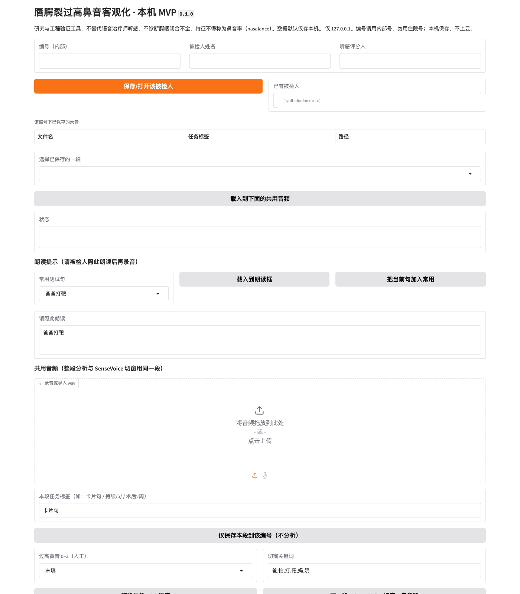

# Nasal Acoustics MVP — Objective Hypernasality Feature Explorer for Cleft Lip & Palate (CLP)

> **Disclaimer:** Research and education aid only. This tool does **not** diagnose velopharyngeal insufficiency (VPI) or any condition, and its features are not a validated "nasalance" score. Perceptual ratings are entered by qualified clinicians. Do not upload identifiable patient data.



## What it does
A local-only (127.0.0.1) app that extracts acoustic features related to hypernasality from short Mandarin speech prompts used in CLP speech follow-up:
- Synthetic vowel demos (/a i u/, low vs. high nasal stereo simulation)
- Word-level windowing of a prompt card sentence via SenseVoiceSmall (FunASR/ModelScope)
- Praat-based features (parselmouth), per-word JSON/CSV output, plots
- Self-referenced index and simulated pre/post-op comparison report (PDF)
- Gradio UI with pseudonymous case codes; data never leaves the machine

## Stack
Python 3, numpy, scipy, soundfile, matplotlib, praat-parselmouth, torch/torchaudio, funasr, modelscope, gradio.

## Run
```bash
python -m venv .venv && source .venv/bin/activate
pip install -r requirements.txt
python -m nasal_mvp demo          # synthetic vowels -> output/
python -m nasal_mvp demo-stereo
python -m nasal_mvp ui --port 7860  # http://127.0.0.1:7860
# word alignment (downloads ~1GB model on first run)
export MODELSCOPE_CACHE="$PWD/.modelscope_cache"; export NASAL_MVP_DEVICE=cpu
python -m nasal_mvp align-demo
python -m nasal_mvp report
```

## Privacy
No recordings are included. Only synthetic audio is used for demos. Never commit clinical WAVs, names, or hospital IDs.

## Status
S1 MVP: pipeline works on synthetic and self-recorded test audio. Missing: ethics approval, real paired pre/post-op data, clinician perceptual gold standard.

## Built with
Cursor, during MLH Global Hack Week: Hacktoberfest 2026.

## License
MIT — see LICENSE
